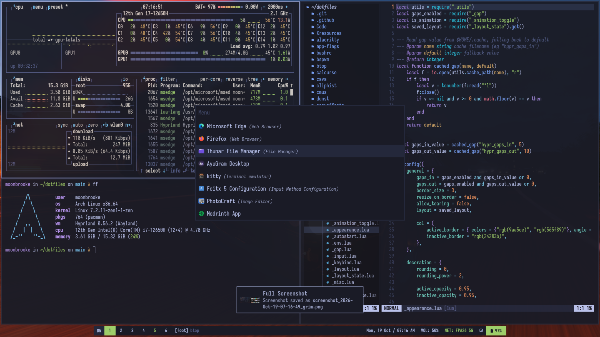

# dotfiles

Only [Hyprland](https://hypr.land/) setup is used regularly. The other WM/Compositor configurations in this dotfiles are either experimental or abandoned.

### Setup

**IMPORTANT:** DO NOT USE the install scripts as they are intended for personal purpose. And folders in this repo are structured to create symlinks using [GNU Stow](https://www.gnu.org/software/stow/). **Use at your own risk**!

Clone the repo into your home directory then `cd` into it. Run `stow <folder-name>` to create the symlink in your `~/.config` folder.

My current setup consists of the following:

```bash
# The configs you need to stow. You can stow multiple folders at once.
btop dunst fastfetch hypr foot nvim rofi waybar scripts yazi zshrc app-flags mimeapps
```

- WM/Compositor: [Hyprland](https://hypr.land/)
- Display Manager: None (Login via TTY)
- Colors: switchable — Tokyo Night / Tokyo Dawn (see [Color themes](#color-themes))
- Terminal: [foot](https://codeberg.org/dnkl/foot)
- Shell: [zsh](https://www.zsh.org/)
- Prompt: [Oh My ZSH](https://ohmyz.sh/)
- Status Bar: [Waybar](https://github.com/Alexays/Waybar)
- Menu: [rofi](https://github.com/davatorium/rofi)
- Screenshot: [grim](https://sr.ht/~emersion/grim/) with [slurp](https://github.com/emersion/slurp)+[jq](https://jqlang.org/)
- File Manager: [Thunar](https://docs.xfce.org/xfce/thunar/start), [yazi](https://github.com/sxyazi/yazi)
- Sysfetch: [fastfetch](https://github.com/fastfetch-cli/fastfetch)
- Editor: [Neovim](https://neovim.io/), [VS Code](https://code.visualstudio.com/)
- Font: [CaskaydiaCove Nerd Font](https://www.nerdfonts.com/font-downloads), [Sarasa Gothic](https://github.com/be5invis/sarasa-gothic), [FiraMono Nerd Font](https://www.nerdfonts.com/font-downloads), [IosevkaTerm Nerd Font](https://www.nerdfonts.com/font-downloads), [Ricty Nerd Font](https://rictyfonts.github.io/) (Japanese font), [Noto CJK](https://github.com/notofonts/noto-cjk) (Chinese, Japanese, Korean fonts)

### Color themes

`SUPER + T` opens the rofi picker. Available themes: **Tokyo Night** (default)
and **Tokyo Dawn**.

```bash
theme              # rofi picker (SUPER + T)
theme list         # both themes with a terminal color preview
theme set tokyodawn
theme set tokyonight
theme current
```

Colors live in `scripts/scripts/themes/palettes/<id>.conf` as `T_*` variables —
that is the only place a color should be edited. Everything else is generated
from it and re-applied live, without logging out:

| Component | How it is themed |
| --- | --- |
| waybar | `style.css` imports `themes/current.css`; the few modules with inline pango colors get rewritten |
| rofi | `config.rasi` / `clipboard.rasi` point at `themes/current.rasi` |
| foot | `foot.ini` keeps both `[colors-dark]` and `[colors-light]`; the switcher flips `initial-color-theme` and signals foot |
| kitty | `kitty.conf` includes `current.conf` (colors + tab bar templates) |
| btop | `btop.conf` uses `color_theme = "current"` |
| dunst | urgency colors rewritten in place in `dunstrc`, then `dunstctl reload` |
| hyprland | borders/shadows come from `~/.cache/theme_colors.lua`, applied with `hyprctl eval` |
| scripts, keyviz | read the palette at runtime via `. "$HOME/scripts/themes/colors"` |
| fastfetch | nothing to do — it uses ANSI indices and follows the terminal |

The `current.*` pointers are generated symlinks and are gitignored; the
per-theme rendered files are tracked so switching themes stays diff-free. On a
fresh clone, `~/scripts/theme apply` in the Hyprland autostart recreates them.

### Using the palette in a script

```bash
#!/usr/bin/env bash
. "$HOME/scripts/themes/colors"

rofi -theme-str "window {border: 3px; border-color: $T_BG_ALT;}"
notify-send 'Settings' "Done <span color=\"$T_GREEN\">OK</span>"
```

`themes/check` lints that usage — it catches `$T_*` inside single quotes (which
the shell would pass through literally, so rofi rejects it) and scripts that use
`$T_*` without loading the palette:

```bash
themes/check
```

GTK/Qt applications keep their Dracula theme in both modes, so Tokyo Dawn only
lightens the terminal, bars, menus, notifications, and window borders.

### Screenshot


